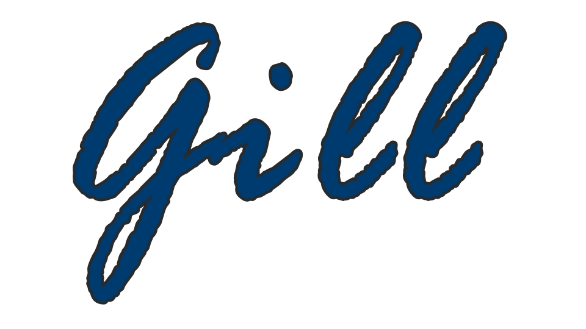

<div align=center>
    
</div>

# ...the solution to C

Gill is a general-purpose, imperative, functional systems programming language that emphasizes memory safety, inspired by C3, Rust, and D.
```rust
import stdlib;

fn main() i32 // can return 'nil' too, which means 'void'
{
	printn("Hello");
	return 0;
}
```
