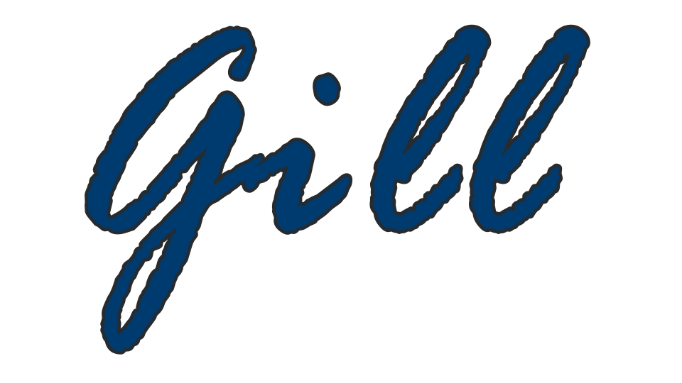

People are **free** to contribute to the Gill project.

## Code of conduct

Examples of **good** behavior by participants include:
* Using welcoming and inclusive language
* Being respectful of differing viewpoints and experiences
* Gracefully accepting constructive criticism
* Focusing on what is best for the community
* Showing empathy towards other community members

Examples of **bad** behavior by participants include:

* The use of sexualized language or imagery and unwelcome sexual attention or
 advances
* Trolling (ragebait), insulting/derogatory comments, personal or political attacks
* Public or private harassment
* Publishing others' private information, such as a physical or electronic address, without explicit permission
* Other conduct which could reasonably be considered inappropriate in a professional setting

## Reporting an issue

* Opening an issue on GitHub.
* Messaging @tacoma6267 on Discord.
* Stating your issue on the Point Dev Discord server.
* **note**: Make sure to look for an existing issue before opening a dupe.

## Bugs
Verify you are using the latest version of Gill. 

Make sure to provide the description of the bug.
